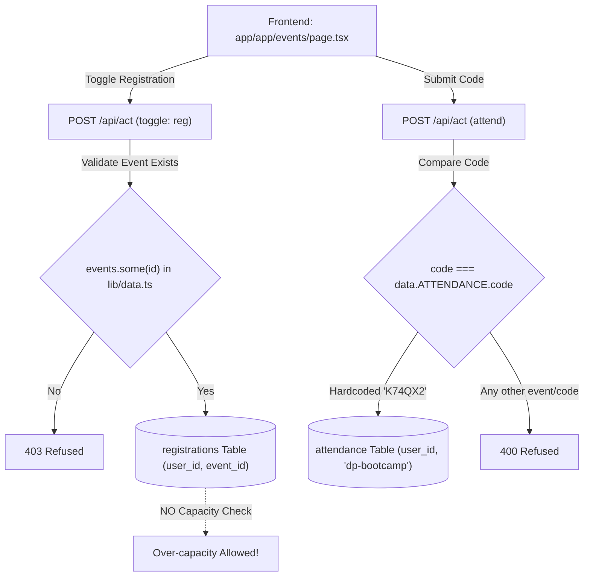
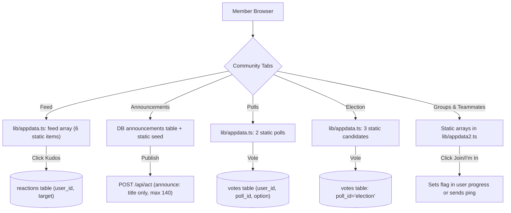
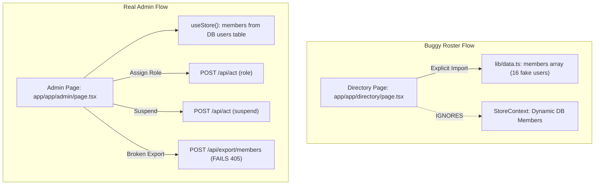
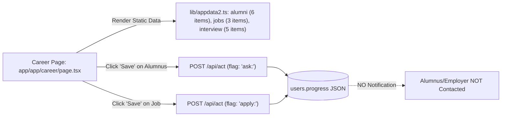
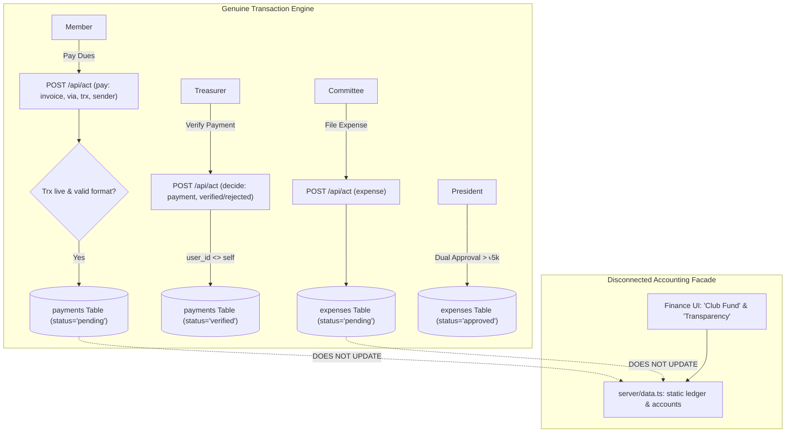
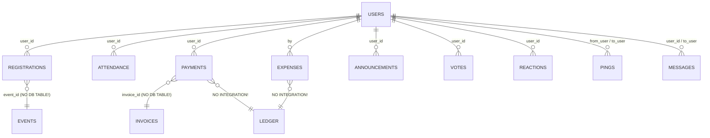
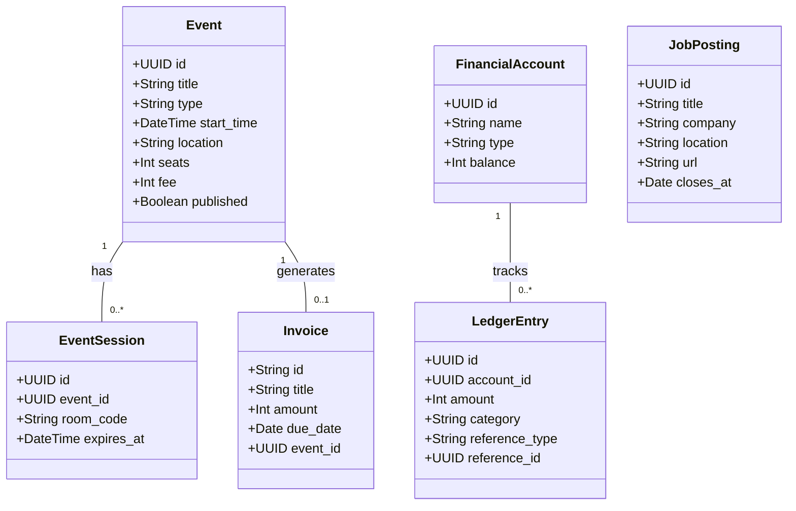
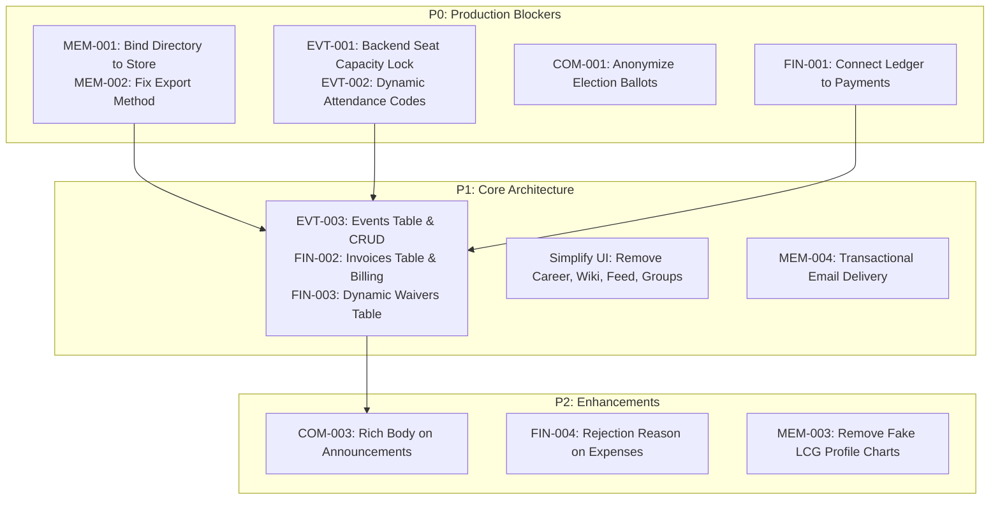

# Comprehensive Pre-Production Audit: FECPC Club Section

**Document Version:** 1.0.0  
**Audit Date:** November 2026  
**Auditor:** Senior Software Engineer, Product Analyst & Technical Auditor  
**Application:** FECPC (Faridpur Engineering College Programming Club) Web Platform  
**Target Scope:** Club Section (Events, Community, Members, Alumni & Jobs, Wiki, Finance) & Direct Dependencies  

---

## 1. Executive Summary

### 1.1 Overall State of the Club Section
The FECPC application was initiated using rapid AI-assisted ("vibe coding") patterns. While this approach produced a visually compelling, retro-styled user interface, a deep architectural and code-level investigation reveals a **two-tiered reality**:
1. **The Core Financial & Administrative Transaction Engine** (Payments submission/verification, Dual-approval expense claims, Application acceptance, and Role assignments) has received thoughtful backend security hardening, advisory locking, and transaction controls.
2. **The Content, Discovery, and Community Layers** (Events catalog, Community feed/discussions, Member directory, Alumni & Jobs board, Wiki knowledge base, and Club fund accounting) are largely **visual facades constructed over static, hardcoded TypeScript arrays**.

In critical user journeys, the user interface simulates interactions by writing ephemeral flags into a generic `jsonb` progress blob (`users.progress`) or the key-value store (`club`), rather than interacting with dedicated relational database entities.

### 1.2 Estimated Implementation Completeness

| Sub-Module | Frontend UI | Backend API | Database Model | Data Dynamism | Production Completeness |
|---|---|---|---|---|---|
| **Events** | 85% | 40% | 20% (Reg/Att only) | Mocked (Events static) | **30% (Partially Implemented)** |
| **Community** | 90% | 35% | 25% (Announce/Votes) | Mocked (Feed/Groups/Ideas) | **25% (Partially Implemented)** |
| **Members** | 90% | 85% | 90% | Disconnected UI (Static array) | **50% (Broken Integration)** |
| **Alumni & Jobs** | 70% | 0% | 0% (No tables) | 100% Hardcoded | **10% (UI Only / Mocked)** |
| **Wiki** | 50% | 0% | 0% (No tables) | 100% Hardcoded | **10% (UI Only / Mocked)** |
| **Finance** | 95% | 75% | 60% (Pay/Exp only) | Mixed (Fund/Ledger mocked) | **60% (Partially Implemented)** |
| **Overall Club Section** | **80%** | **39%** | **32%** | **High Hardcoding Ratio** | **31% Overall Readiness** |

### 1.3 Major Production Blockers (P0 / Critical)
1. **Broken Member Directory Data Binding ([MEM-001](#finding-mem-001)):** The member directory page (`app/app/directory/page.tsx`) explicitly imports and renders the hardcoded seed array from `lib/data.ts` rather than querying the dynamic database roster. Real members onboarded through the application form never appear in the directory.
2. **Broken Member CSV Export API Contract ([MEM-002](#finding-mem-002)):** The admin interface issues a `POST` request to `/api/export/members`, but the route handler only defines a `GET` method. The member export functionality fails with HTTP 405 (Method Not Allowed).
3. **Missing Event Capacity and Waitlist Enforcement ([EVT-001](#finding-evt-001)):** Backend event registration (`server/actions.ts`) lacks seat capacity checks. The frontend UI displays a "Join waitlist" button when seats are full, but clicking it unconditionally inserts an active registration into the database, bypassing all attendance limits.
4. **Hardcoded Single-Event Attendance Room Code ([EVT-002](#finding-evt-002)):** Attendance validation in `server/actions.ts` is hardcoded to a single global constant (`ATTENDANCE = { event: "dp-bootcamp", code: "K74QX2" }`). Event organisers cannot generate codes for any other event without modifying server source code.
5. **Ballot Privacy Breach in Committee Elections ([COM-001](#finding-com-001)):** The UI guarantees that "Nobody, officers included, is shown how you voted," but the backend persists votes in `votes (user_id, poll_id, option)` where `user_id` is the primary key. Individual voting choices are directly linked to voter identities in the database.
6. **Decoupled Financial Ledger & Incomplete Invoicing ([FIN-001](#finding-fin-001)):** The "Club fund", "Cash flow", "Budgets", and "Transparency" tabs display hardcoded figures from `server/data.ts`. Approving expenses or verifying payments has zero effect on account balances or ledger entries. Furthermore, events with non-zero registration fees (e.g., `intra-contest` ৳200) generate no payable invoices, preventing fee collection.

### 1.4 Overall Production Readiness
**Verdict: NOT PRODUCTION READY.**  
The Club section cannot be deployed to real users without immediate remediation. Core expectations of a production student organization system—discovering real members, registering for events within true seat limits, taking attendance across arbitrary workshops, submitting job opportunities, creating knowledge base documents, and managing authentic financial balances—are currently non-functional or simulated.

---

## 2. Club Section Feature Inventory

The Club section is mounted in the main application navigation under the `"Club"` group (`components/app/Shell.tsx#L18`):

```typescript
// components/app/Shell.tsx#L18
{ g: "Club", items: [
  ["/app/events", "Events"],
  ["/app/community", "Community"],
  ["/app/directory", "Members"],
  ["/app/career", "Alumni & jobs"],
  ["/app/wiki", "Wiki"],
  ["/app/finance", "Finance"]
] }
```

| Feature Name | Route / Component Location | Backend Handler | Database Entities | Declared Purpose | Actual Reality |
|---|---|---|---|---|---|
| **Events: Upcoming Catalog** | `app/app/events/page.tsx#L19-L37` | `server/actions.ts#L55-L59` | `registrations` | Discover events, view seats, register/cancel | Lists 7 hardcoded items; seat counts are mock math; unlimited registration |
| **Events: Attendance Check-in** | `app/app/events/page.tsx#L20-L26` | `server/actions.ts#L161-L164` | `attendance` | Verify in-person presence via rotating code | Code is hardcoded to `K74QX2` and only works for `dp-bootcamp` |
| **Events: Calendar & iCal** | `components/app/Extras.tsx#L106-L111` | None (Client-side) | None | View monthly schedule and export `.ics` | Hardcoded November 2026 calendar; static `.ics` file generator |
| **Events: Volunteer Shifts** | `components/app/Extras.tsx#L112-L115` | `server/actions.ts#L65-L74` | `attendance` (key `vol:*`) | Sign up for contest-day volunteer duties | Hardcoded 4 shifts; concurrency locked via `pg_advisory_xact_lock` |
| **Events: Event Feedback** | `components/app/Extras.tsx#L116-L124` | `server/actions.ts#L124,L183` | `votes` (`fb:freshers`), `messages` (`kind='feedback'`) | Collect post-event attendee ratings & thoughts | Hardcoded specifically to "Freshers' Cup 2026" only |
| **Events: Certificates** | `components/app/Extras.tsx#L125-L130` | None | None | Display & print participation certificates | Filtered against 3 static records in `lib/data.ts`; no issuance system |
| **Events: Organiser View** | `app/app/events/page.tsx#L38-L44` | `server/state.ts#L64-L65` | `registrations`, `attendance`, `messages` | Monitor real-time room attendance & feedback | Displays registrants and attendance count for hardcoded events |
| **Community: Feed** | `app/app/community/page.tsx#L20-L24` | `server/actions.ts#L60-L64` | `reactions` | Activity feed & kudos cheering | Static list of 6 items; members cannot create activity posts |
| **Community: Announcements** | `app/app/community/page.tsx#L25-L41` | `server/actions.ts#L175-L182` | `announcements` | Official officer broadcasts | Functional plain-text title broadcast; no rich body, edit, or delete |
| **Community: Polls** | `app/app/community/page.tsx#L42-L48` | `server/actions.ts#L121-L131` | `votes` | Member voting on club topics | 2 hardcoded static polls; static base tallies; cannot create polls |
| **Community: Election** | `app/app/community/page.tsx#L49-L57` | `server/actions.ts#L121-L131` | `votes` | Annual committee presidential ballot | 3 hardcoded candidates; unchangeable single vote; de-anonymized in DB |
| **Community: Ideas** | `app/app/community/page.tsx#L58-L60` | `server/actions.ts#L60-L64` | `reactions` | Crowdsourced workshop & session topics | 4 static ideas; upvoting toggles reaction table; no submission form |
| **Community: Groups** | `components/app/Extras.tsx#L91-L94` | `server/actions.ts#L78-L92` | `users.progress` (`flags`) | Specialized interest tracks | 5 hardcoded groups; joining only flips a client preference flag |
| **Community: Teammates** | `components/app/Extras.tsx#L95-L98` | `server/actions.ts#L194-L201` | `pings` (`kind='team'`) | Matchmaking for hackathons and contests | 3 static hardcoded requests; creates ping row; cannot post requests |
| **Community: Suggestions** | `components/app/Extras.tsx#L77-L88` | `server/actions.ts#L183-L193` | `messages` (`kind='suggest'`) | Anonymous complaints / ideas to executives | Functional: stored with `user_id = null`, delivered to admin dashboard |
| **Members: Directory** | `app/app/directory/page.tsx#L12-L39` | None (Disconnected) | None (Bypasses DB) | Search & filter active club roster | **Broken:** imports static array of 16 users; dynamic users invisible |
| **Members: Profile Management** | `app/app/profile/page.tsx#L36-L77` | `server/actions.ts#L209-L214` | `users` | View member card, edit name/dept/batch | Functional for self-updates; draws fake charts via LCG if handle missing |
| **Members: Role Administration** | `components/app/Extras.tsx#L171-L182` | `server/actions.ts#L269-L278` | `users`, `audit` | Grant/revoke officer titles & permissions | Functional: gated to President/Super Admin; updates role & title; audited |
| **Members: Account Suspension** | `components/app/Extras.tsx#L171-L182` | `server/actions.ts#L279-L288` | `users`, `sessions`, `audit` | Suspend compromised or inactive accounts | Functional: revokes active sessions immediately; prevents login |
| **Members: Invite & Password Reset** | `components/app/Extras.tsx#L171-L182` | `server/actions.ts#L290-L300` | `users`, `audit` | Issue single-use 7-day token onboarding links | Functional token generator; requires manual out-of-band delivery |
| **Members: Onboarding Pipeline** | `app/api/apply/route.ts`, `app/app/admin/page.tsx` | `server/actions.ts#L227-L241,L320-L329` | `applications`, `users` | Public join form to executive approval | Functional approval flow; creates user row with invite hash |
| **Alumni & Jobs: Alumni Directory** | `app/app/career/page.tsx#L17-L20` | `server/actions.ts#L78-L92` | `users.progress` (`flags`) | Discover graduated mentors & their cities | 6 hardcoded alumni; "Save" only flips `ask:<name>` in user progress |
| **Alumni & Jobs: Job Board** | `app/app/career/page.tsx#L21-L23` | `server/actions.ts#L78-L92` | `users.progress` (`flags`) | Internships and referrals from alumni | 3 hardcoded job postings; "Save" only flips `apply:<id>` in progress |
| **Alumni & Jobs: Interview Prep** | `app/app/career/page.tsx#L24-L26` | None | None | Track interview problem progress | 5 static progress bars; zero interactive or dynamic backing |
| **Wiki: Knowledge Base** | `app/app/wiki/page.tsx#L8-L22` | `server/actions.ts#L49-L54` | `users.progress` (`done`) | Club guides, ICPC rules, judge setup | 3 static articles; "Mark as read" awards +15 XP; zero CMS capabilities |
| **Finance: My Dues & Invoices** | `app/app/finance/page.tsx#L32-L61` | `server/actions.ts#L145-L160` | `payments` | View owed fees and submit mobile wallet trx | Matches 2 static invoices; submissions validate trx & mobile format |
| **Finance: Payment Verification** | `app/app/finance/page.tsx#L62-L74` | `server/actions.ts#L217-L226` | `payments`, `audit` | Treasurer verification against statement | Functional: prevents self-verification; updates payment status & note |
| **Finance: Expense Claims** | `app/app/finance/page.tsx#L75-L87` | `server/actions.ts#L202-L208` | `expenses`, `audit` | Committee members file expense claims | Functional: records requester, amount, description, and event |
| **Finance: Dual Expense Approval** | `app/app/finance/page.tsx#L88-L100` | `server/actions.ts#L243-L256` | `expenses`, `audit` | Approve/reject claims; 2-officer flow > ৳5k | Functional: row locking prevents race conditions; blocks self-approval |
| **Finance: Waivers** | `components/app/Extras.tsx#L134-L147` | `server/actions.ts#L257-L268` | `decisions` (`kind='waiver'`) | Propose & approve financial fee waivers | Two-officer workflow; waiver items are hardcoded in `server/data.ts` |
| **Finance: Club Fund & Transparency**| `app/app/finance/page.tsx#L101-L116`| None | None | Organization budget, accounts & transparency | 100% hardcoded sample figures; disconnected from payments and expenses |

---

## 3. Individual Feature Audit

### 3.1 Events



#### Detailed Findings

##### Finding EVT-001: Missing Capacity Enforcement & Illusory Waitlist
- **Module:** Events / Registration
- **Implementation Status:** Broken
- **User Relevance:** ESSENTIAL
- **Priority:** P0
- **Source Location:** [server/actions.ts#L55-L59](file:///home/light/Work/working-on/FECPC/server/actions.ts#L55-L59), [app/app/events/page.tsx#L27,L35](file:///home/light/Work/working-on/FECPC/app/app/events/page.tsx#L27-L35)
- **Evidence & Explanation:**  
  In `app/app/events/page.tsx`, the client checks if an event is full: `full = e.taken + (counts.reg[e.id] ?? 0) >= e.seats`. When full, the button label changes to `"Join waitlist"`. However, clicking it invokes:
  ```typescript
  act("toggle", { list: "reg", id: e.id, on: true })
  ```
  On the backend (`server/actions.ts#L55-L59`), the handler only verifies that the event exists in static memory:
  ```typescript
  else if (list === "reg") {
    need(events.some((e) => e.id === id), "That event does not exist.");
    const has = (await c.query(`select 1 from registrations where user_id = $1 and event_id = $2`, [a.id, id])).rowCount! > 0;
    if (now(has)) await c.query(`insert into registrations values ($1, $2) on conflict do nothing`, [a.id, id]);
    else await c.query(`delete from registrations where user_id = $1 and event_id = $2`, [a.id, id]);
  }
  ```
  There is **zero capacity verification** in SQL or server logic. There is no `waitlist` table, queue position, or waitlist status column. An oversubscribed event accepts an infinite number of registrations, defeating physical venue seat limits (e.g., Lab 3 CSE Building: 60 seats).
- **Recommended Action:**  
  1. Add a real `events` table with `seats` and `status` columns.
  2. Implement an atomic registration check inside a transaction using row-level locking (`SELECT count(*) FROM registrations WHERE event_id = $1 FOR UPDATE`).
  3. Create an explicit `event_waitlist` table with queue position timestamps.

##### Finding EVT-002: Hardcoded Global Attendance Room Code & Single-Event Restriction
- **Module:** Events / Attendance
- **Implementation Status:** Hardcoded / Broken
- **User Relevance:** ESSENTIAL
- **Priority:** P0
- **Source Location:** [server/data.ts#L48](file:///home/light/Work/working-on/FECPC/server/data.ts#L48), [server/actions.ts#L161-L164](file:///home/light/Work/working-on/FECPC/server/actions.ts#L161-L164), [app/app/events/page.tsx#L20-L26](file:///home/light/Work/working-on/FECPC/app/app/events/page.tsx#L20-L26)
- **Evidence & Explanation:**  
  In `server/data.ts#L48`:
  ```typescript
  export const ATTENDANCE = { event: "dp-bootcamp", code: "K74QX2" }; // shortcut: one fixed code; rotate per class when attendance goes live
  ```
  In `server/actions.ts#L161-L164`:
  ```typescript
  async attend(c, a, _p, i) {
    if (String(i.code ?? "").replace(/[^a-z0-9]/gi, "").toUpperCase() !== data.ATTENDANCE.code) throw new Fail(400, "That code is wrong or has expired. Read it off the projector again.");
    await c.query(`insert into attendance values ($1, $2) on conflict do nothing`, [a.id, data.ATTENDANCE.event]);
  }
  ```
  The attendance verification logic ignores whatever event is occurring and exclusively verifies against `"K74QX2"`, inserting attendance records for `"dp-bootcamp"`. It is technically impossible to take attendance for any of the other 6 events (e.g., `git-night`, `icpc-mock-3`). Furthermore, the public website claims that "The attendance code rotates and expires" (`app/(site)/events/page.tsx#L87`), but in reality, the code is permanent and never expires.
- **Recommended Action:**  
  Create an `event_sessions` or `attendance_codes` table storing `(event_id, code_hash, expires_at, created_by)`. Provide executive roles with an endpoint to generate rotating 6-character room codes with 10-15 minute validity windows.

##### Finding EVT-003: Non-Existent Event Persistence (Static Memory Catalog)
- **Module:** Events / Management
- **Implementation Status:** Hardcoded / Mocked
- **User Relevance:** ESSENTIAL
- **Priority:** P1
- **Source Location:** [lib/data.ts#L64-L73](file:///home/light/Work/working-on/FECPC/lib/data.ts#L64-L73)
- **Evidence & Explanation:**  
  The application has no database table for events (`schema.sql` contains no `CREATE TABLE events`). All 7 events (`dp-bootcamp`, `weekly-42`, `git-night`, `icpc-mock-3`, `alumni-talk`, `hack-night`, `intra-contest`) are static objects in `lib/data.ts`. There is no administrative interface or API to schedule a new workshop, postpone a contest, modify a venue, or change seat limits.
- **Recommended Action:**  
  Create an `events` table in PostgreSQL with columns for `id`, `title`, `type`, `date`, `time`, `place`, `seats`, `fee`, `blurb`, `published`, and `created_at`. Expose event creation and modification APIs restricted by `event.publish` capability.

##### Finding EVT-004: Incomplete Paid Event Invoicing Integration
- **Module:** Events / Finance Integration
- **Implementation Status:** Partially Implemented
- **User Relevance:** ESSENTIAL
- **Priority:** P1
- **Source Location:** [lib/appdata.ts#L20-L25](file:///home/light/Work/working-on/FECPC/lib/appdata.ts#L20-L25), [lib/data.ts#L71-L72](file:///home/light/Work/working-on/FECPC/lib/data.ts#L71-L72)
- **Evidence & Explanation:**  
  Two events have non-zero fees: `hack-night` (৳150) and `intra-contest` (৳200). In `lib/appdata.ts`, only `hack-night` has an associated invoice:
  ```typescript
  export const invoices = [
    { id: "INV-2611", label: "Semester subscription, Autumn 2026", amount: 300, due: "2026-11-16" },
    { id: "INV-2612", label: "Winter Hack Night registration", amount: 150, due: "2026-12-03", event: "hack-night" },
  ];
  ```
  When a member registers for `intra-contest`, the UI shows `"Register · ৳200 invoice"` (`app/app/events/page.tsx#L35`), but no invoice exists for `intra-contest`. The registration succeeds, but no invoice is added to `myInvoices(s.reg)`. The club cannot collect registration dues for its flagship annual contest through the platform.
- **Recommended Action:**  
  Dynamically generate an invoice entry in a real database `invoices` table whenever a user registers for an event where `fee > 0`.

##### Finding EVT-005: Mock Calendar, Volunteer & Certificate Systems
- **Module:** Events / Sub-Features
- **Implementation Status:** Hardcoded / Mocked
- **User Relevance:** USEFUL
- **Priority:** P2
- **Source Location:** [components/app/Extras.tsx#L106-L130](file:///home/light/Work/working-on/FECPC/components/app/Extras.tsx#L106-L130)
- **Evidence & Explanation:**  
  1. **Calendar:** The calendar hardcodes a 30-day November 2026 grid (`Array.from({ length: 30 })`). Any event outside November 2026 cannot be rendered.
  2. **Volunteer Shifts:** Shifts are hardcoded in `volunteerShifts` (`lib/appdata2.ts#L93`). While concurrency locking on shift slots is properly handled via `pg_advisory_xact_lock` in `server/actions.ts#L68`, new shifts cannot be created for other events.
  3. **Certificates:** Displays static objects from `certificates` in `lib/data.ts#L143-L147`. New certificates cannot be issued, revoked, or linked to verified event attendance.
- **Recommended Action:**  
  Migrate shifts and certificates to relational database tables with proper administrative management workflows.

---

### 3.2 Community



#### Detailed Findings

##### Finding COM-001: De-Anonymized Committee Election Voting
- **Module:** Community / Election
- **Implementation Status:** Partially Implemented / Security Risk
- **User Relevance:** ESSENTIAL
- **Priority:** P0
- **Source Location:** [app/app/community/page.tsx#L50-L54](file:///home/light/Work/working-on/FECPC/app/app/community/page.tsx#L50-L54), [server/actions.ts#L121-L131](file:///home/light/Work/working-on/FECPC/server/actions.ts#L121-L131), [server/schema.sql#L31](file:///home/light/Work/working-on/FECPC/server/schema.sql#L31)
- **Evidence & Explanation:**  
  The interface explicitly promises secrecy:
  ```tsx
  // app/app/community/page.tsx#L50
  <p className="body">One member, one vote, and it cannot be changed. Nobody, officers included, is shown how you voted.</p>
  ```
  However, in `server/schema.sql#L31`:
  ```sql
  create table if not exists votes (user_id text not null references users on delete cascade, poll_id text not null, option text not null, primary key (user_id, poll_id));
  ```
  In `server/actions.ts#L128`:
  ```typescript
  const r = await c.query(`insert into votes values ($1, $2, $3) on conflict (user_id, poll_id) do nothing`, [a.id, poll, option]);
  ```
  Every ballot cast for president is directly stored with the member's `user_id` as the primary key. Any developer, database administrator, or future SQL query can instantly see which student voted for which candidate. While `server/state.ts#L43` filters out `election` from being sent back in `counts.votes`, the ballot data is **not anonymous at rest**.
- **Recommended Action:**  
  Separate voter eligibility tracking from ballot selection. Store a boolean in a `voted_members (user_id, election_id)` table, and insert the unlinked ballot into a separate `election_ballots (election_id, candidate_id, random_token)` table without any foreign key to `users`.

##### Finding COM-002: Mock Community Feed Without User Authoring Capabilities
- **Module:** Community / Feed
- **Implementation Status:** UI Only / Mocked
- **User Relevance:** USEFUL
- **Priority:** P1
- **Source Location:** [lib/appdata.ts#L47-L54](file:///home/light/Work/working-on/FECPC/lib/appdata.ts#L47-L54), [app/app/community/page.tsx#L20-L24](file:///home/light/Work/working-on/FECPC/app/app/community/page.tsx#L20-L24)
- **Evidence & Explanation:**  
  The "Feed" tab displays 6 hardcoded items from `lib/appdata.ts#L47` (e.g., `"nadia reached Candidate Master"`, `"rahim solved a 2100-rated problem"`). There is no form, API endpoint, or database table allowing members to create posts, share updates, or comment. The only interactive element is clicking "Kudos", which writes to the `reactions` table keyed against the static string IDs (`f1`..`f6`).
- **Recommended Action:**  
  Either implement a lightweight `posts` and `comments` table with moderation tools, or simplify the Community tab to focus exclusively on official Announcements and Polls, removing the fake social feed.

##### Finding COM-003: Truncated Announcements (Title Only, No Rich Body or Management)
- **Module:** Community / Announcements
- **Implementation Status:** Partially Implemented
- **User Relevance:** ESSENTIAL
- **Priority:** P1
- **Source Location:** [server/schema.sql#L60](file:///home/light/Work/working-on/FECPC/server/schema.sql#L60), [server/actions.ts#L175-L182](file:///home/light/Work/working-on/FECPC/server/actions.ts#L175-L182), [app/app/community/page.tsx#L27-L32](file:///home/light/Work/working-on/FECPC/app/app/community/page.tsx#L27-L32)
- **Evidence & Explanation:**  
  In `server/schema.sql#L60`:
  ```sql
  create table if not exists announcements (id int generated always as identity primary key, user_id text not null references users, title text not null, created_at timestamptz not null default now());
  ```
  The announcements table contains only a `title` column. When officers post an announcement (`server/actions.ts#L177`), they are restricted to a single input of 3 to 140 characters. There is no `body` column, Markdown formatting, file attachment, or pinned status. Furthermore, there is no ability to edit or delete announcements after publication.
- **Recommended Action:**  
  Add `body TEXT NOT NULL DEFAULT ''`, `pinned BOOLEAN NOT NULL DEFAULT FALSE`, and `updated_at TIMESTAMPTZ` columns to `announcements`. Provide editing and deletion actions for announcement authors and administrators.

##### Finding COM-004: Static Polls & Static Ideas
- **Module:** Community / Polls & Ideas
- **Implementation Status:** Hardcoded / Mocked
- **User Relevance:** OPTIONAL
- **Priority:** P2
- **Source Location:** [lib/appdata.ts#L60-L63,L69](file:///home/light/Work/working-on/FECPC/lib/appdata.ts#L60-L63), [app/app/community/page.tsx#L42-L48,L58-L60](file:///home/light/Work/working-on/FECPC/app/app/community/page.tsx#L42-L48)
- **Evidence & Explanation:**  
  Polls (`p1` and `p2`) and Ideas are hardcoded in `lib/appdata.ts`. Poll vote calculations sum static base numbers with live entries from `votes`: `total = p.opts.reduce((a, o) => a + o[1] + (live[o[0]] ?? 0), 0)`. Officers cannot create new polls, close finished polls, or solicit new ideas from members.
- **Recommended Action:**  
  Implement a dynamic `polls` and `poll_options` relational schema or deprecate the feature in favor of focused announcements.

---

### 3.3 Members



#### Detailed Findings

##### Finding MEM-001: Member Directory Bypasses Database & Displays Static Seeds
- **Module:** Members / Directory
- **Implementation Status:** Broken / Hardcoded
- **User Relevance:** ESSENTIAL
- **Priority:** P0
- **Source Location:** [app/app/directory/page.tsx#L7,L13,L19](file:///home/light/Work/working-on/FECPC/app/app/directory/page.tsx#L7-L19)
- **Evidence & Explanation:**  
  In `app/app/directory/page.tsx`:
  ```typescript
  // Line 7:
  import { cfTitle, members } from "@/lib/data";
  ...
  // Line 13:
  const { s, me, act } = useStore();
  ...
  // Line 19:
  const list = members.filter((m) => (m.name + m.handle).toLowerCase().includes(q.toLowerCase()) && ...);
  ```
  The component imports the static `members` array directly from `lib/data.ts` (16 fake student profiles). Notice that in line 13, it does **not** destructure `members` from `useStore()`. Even though `server/state.ts#L48` queries the live PostgreSQL database and passes dynamic members to the store, the directory page completely ignores dynamic data. Any newly accepted student or updated batch information will **never render in the member directory**.
- **Recommended Action:**  
  Change line 13 to `const { s, me, act, members } = useStore();` and remove `members` from the `lib/data` import on line 7.

##### Finding MEM-002: Member CSV Export Fails Due to HTTP Method Mismatch
- **Module:** Members / Export
- **Implementation Status:** Broken
- **User Relevance:** USEFUL
- **Priority:** P0
- **Source Location:** [app/app/admin/page.tsx#L25-L29](file:///home/light/Work/working-on/FECPC/app/app/admin/page.tsx#L25-L29), [app/api/export/members/route.ts#L4](file:///home/light/Work/working-on/FECPC/app/api/export/members/route.ts#L4)
- **Evidence & Explanation:**  
  In `app/app/admin/page.tsx#L26`:
  ```typescript
  const res = await fetch("/api/export/members", { method: "POST", headers: { "content-type": "application/json" }, body: "{}" });
  ```
  In `app/api/export/members/route.ts#L4`:
  ```typescript
  export const GET = () => respond(async () => new Response(await exportMembers(await signedIn()), { ... }));
  ```
  The route handler exports **only a `GET` method**. When an officer clicks "Export members (CSV)", the browser sends a `POST` request, receiving HTTP 405 Method Not Allowed. The export feature is completely inoperable in the UI.
- **Recommended Action:**  
  Change the client call to `GET`, or add `export const POST = GET;` in `app/api/export/members/route.ts`.

##### Finding MEM-003: Fabricated Chart Generation via Linear Congruential Generator (LCG)
- **Module:** Members / Profile
- **Implementation Status:** Hardcoded / Mocked
- **User Relevance:** USEFUL
- **Priority:** P2
- **Source Location:** [app/app/profile/page.tsx#L38-L44](file:///home/light/Work/working-on/FECPC/app/app/profile/page.tsx#L38-L44)
- **Evidence & Explanation:**  
  When a member has not yet linked a Codeforces handle, rather than displaying an empty state or onboarding prompt, the profile screen fabricates activity data:
  ```typescript
  const rnd = lcg(me.name.length * 977);
  const days = data ? ... : Array.from({ length: 364 }, () => (rnd() < 0.45 ? 0 : Math.floor(rnd() * 5)));
  const hist = data?.history ?? Array.from({ length: 14 }, (_, i) => Math.round(800 + ((me.rating - 800) * (i + 1)) / 14 + (rnd() - 0.5) * 90));
  ```
  This creates simulated solve heatmaps and fabricated rating progression lines based on the length of the member's name. This misleads users and violates pre-production data integrity principles.
- **Recommended Action:**  
  Remove the LCG fallback and display an authentic empty state prompting the member to connect their competitive programming judge handle.

##### Finding MEM-004: Lack of Automated Password Delivery on Application Acceptance
- **Module:** Members / Onboarding
- **Implementation Status:** Partially Implemented
- **User Relevance:** ESSENTIAL
- **Priority:** P1
- **Source Location:** [server/actions.ts#L234-L241](file:///home/light/Work/working-on/FECPC/server/actions.ts#L234-L241)
- **Evidence & Explanation:**  
  When the Secretary accepts a membership application, the server generates a 7-day single-use invite token and returns:
  ```typescript
  return `Account created for ${app.name}. Send them this link to set a password. It works once and expires in 7 days: /login?invite=${token}`;
  ```
  Because the platform has no transactional email integration (e.g., Resend, Sendgrid, or SMTP), the officer must manually copy this link from a toast dialog and send it via external social media or messaging platforms. If the officer accidentally closes the dialog, the applicant cannot onboard until an officer manually generates a reset link from Admin → Members.
- **Recommended Action:**  
  Integrate a transactional email provider to automatically email invite tokens to applicant email addresses upon acceptance.

---

### 3.4 Alumni & Jobs



#### Detailed Findings

##### Finding ALM-001: Pseudo-Interactive Alumni & Jobs Board (Client Flag Simulation)
- **Module:** Alumni & Jobs / Entire Feature
- **Implementation Status:** UI Only / Mocked
- **User Relevance:** IRRELEVANT (in current state) / USEFUL (if genuinely implemented)
- **Priority:** P1
- **Source Location:** [app/app/career/page.tsx#L1-L29](file:///home/light/Work/working-on/FECPC/app/app/career/page.tsx#L1-L29), [lib/appdata2.ts#L56-L70](file:///home/light/Work/working-on/FECPC/lib/appdata2.ts#L56-L70)
- **Evidence & Explanation:**  
  The entire module consists of 29 lines of frontend code:
  1. **Alumni Directory:** 6 static alumni are rendered from `lib/appdata2.ts#L56`. If `a.mentor` is true, an action button appears. Clicking it executes:
     ```typescript
     act("flag", { key: "ask:" + a.name, on: true })
     ```
     This does nothing except save a boolean in `users.progress.flags`. It does not show an email, contact link, or LinkedIn profile, nor does it notify the alumnus or create a mentorship inquiry.
  2. **Job Postings:** 3 static jobs are rendered from `lib/appdata2.ts#L64`. Clicking "Save" executes:
     ```typescript
     act("flag", { key: "apply:" + j.id, on: true })
     ```
     This merely flips a local flag. It does not allow uploading a resume, submitting an application, contacting the referrer, or redirecting to an external job portal.
  3. **Interview Prep:** Displays 5 hardcoded progress bars (`Arrays and hashing: 11/18`, etc.) from a static tuple. It has zero problem links or interactive capabilities.
  4. **Database Models:** There are **zero database tables** for alumni, jobs, or applications.
- **Recommended Action:**  
  Either:
  - **Option A (Recommended for pre-production):** Completely remove the `/app/career` route and navigation link. It provides zero practical value to FECPC members and misrepresents application capabilities.
  - **Option B:** Build genuine database models for job postings with external application URLs and verified alumni directories with contact request forwarding.

---

### 3.5 Wiki

#### Detailed Findings

##### Finding WIKI-001: Static Reading List Styled as Wiki Knowledge Base
- **Module:** Wiki / Entire Feature
- **Implementation Status:** UI Only / Hardcoded
- **User Relevance:** IRRELEVANT (as a Wiki) / OPTIONAL (as static guide)
- **Priority:** P2
- **Source Location:** [app/app/wiki/page.tsx#L1-L22](file:///home/light/Work/working-on/FECPC/app/app/wiki/page.tsx#L1-L22), [lib/appdata2.ts#L71-L76](file:///home/light/Work/working-on/FECPC/lib/appdata2.ts#L71-L76)
- **Evidence & Explanation:**  
  The entire Wiki is 22 lines of code:
  - Reads 3 hardcoded articles from `lib/appdata2.ts#L71` (`icpc`, `setup`, `upsolve`).
  - Displays body paragraphs as `<li>` items.
  - Clicking "Mark as read · +15 XP" adds `"wiki:" + w.id` to `users.progress.done`.
  - **Missing functionality:**
    * No page creation or authoring interface.
    * No Markdown or rich-text editor.
    * No page editing or deletion.
    * No category tree, navigation hierarchy, or search index.
    * No revision history (revision numbers like `rev: 7` are hardcoded static integers).
    * No relational database table (`schema.sql` has no `wiki` table).
- **Recommended Action:**  
  Deprecate the term "Wiki". Either fold these 3 onboarding articles into `/app/learn` (Roadmap & library), or postpone full knowledge base development until post-production.

---

### 3.6 Finance



#### Detailed Findings

##### Finding FIN-001: Disconnected Accounting Ledger & Fabricated Fund Totals
- **Module:** Finance / Club Fund & Transparency
- **Implementation Status:** Hardcoded / Mocked
- **User Relevance:** ESSENTIAL
- **Priority:** P0
- **Source Location:** [server/data.ts#L10-L16](file:///home/light/Work/working-on/FECPC/server/data.ts#L10-L16), [server/state.ts#L99,L138](file:///home/light/Work/working-on/FECPC/server/state.ts#L99-L138), [app/app/finance/page.tsx#L101-L116](file:///home/light/Work/working-on/FECPC/app/app/finance/page.tsx#L101-L116)
- **Evidence & Explanation:**  
  In `server/state.ts`:
  ```typescript
  // Line 99:
  if (seesMoney(role)) office.fund = { accounts: [...data.accounts], ledger: data.ledger, budgets: [...data.budgets], cashflow: data.cashflow };
  ...
  // Line 138:
  fundTotal: data.accounts.reduce((a, x) => a + x[1], 0)
  ```
  All balance accounts (`Cash in hand: ৳8,450`, `bKash: ৳21,300`, etc.), ledger transactions, monthly cash flows, and category distributions are hardcoded constants in `server/data.ts`.
  When a member submits a payment and the Treasurer verifies it, the payment record is updated in `payments`, but **the club fund balance does not increase**, no ledger transaction is created, and wallet account balances do not change.
  Similarly, when an expense of ৳14,400 is approved by the President, **no money is deducted from any account**. The entire accounting and transparency system is completely detached from actual transactions.
- **Recommended Action:**  
  1. Create relational tables: `financial_accounts (id, name, type, balance)` and `ledger_entries (id, account_id, type, amount, category, reference_type, reference_id, created_at)`.
  2. Bind payment verification and expense approval directly to ledger entries in an atomic transaction that adjusts account balances.

##### Finding FIN-002: Hardcoded Invoices Array Without Dynamic Creation
- **Module:** Finance / Invoicing
- **Implementation Status:** Hardcoded / Mocked
- **User Relevance:** ESSENTIAL
- **Priority:** P1
- **Source Location:** [lib/appdata.ts#L20-L25](file:///home/light/Work/working-on/FECPC/lib/appdata.ts#L20-L25), [server/actions.ts#L147](file:///home/light/Work/working-on/FECPC/server/actions.ts#L147)
- **Evidence & Explanation:**  
  In `lib/appdata.ts`:
  ```typescript
  export const invoices = [
    { id: "INV-2611", label: "Semester subscription, Autumn 2026", amount: 300, due: "2026-11-16" },
    { id: "INV-2612", label: "Winter Hack Night registration", amount: 150, due: "2026-12-03", event: "hack-night" },
  ];
  ```
  In `server/actions.ts#L147`:
  ```typescript
  const inv = invoices.find((x) => x.id === i.invoice);
  need(inv, "That invoice does not exist.");
  ```
  The platform only recognizes these two hardcoded invoices. The Treasurer cannot issue term dues for Spring 2027, cannot create fine notices, and cannot invoice for new workshops. If the club enters a new academic semester, developers must modify and redeploy source code to collect subscription fees.
- **Recommended Action:**  
  Create an `invoices` table storing `(id, title, amount, due_date, event_id, target_audience, created_at)` with an administrative interface for the Treasurer.

##### Finding FIN-003: Hardcoded Waivers Array in Server Memory
- **Module:** Finance / Waivers
- **Implementation Status:** Hardcoded / Mocked
- **User Relevance:** USEFUL
- **Priority:** P1
- **Source Location:** [server/data.ts#L46](file:///home/light/Work/working-on/FECPC/server/data.ts#L46), [components/app/Extras.tsx#L134-L147](file:///home/light/Work/working-on/FECPC/components/app/Extras.tsx#L134-L147)
- **Evidence & Explanation:**  
  In `server/data.ts#L46`:
  ```typescript
  export const waivers = [
    { id: "w1", who: "jannat", what: "Semester subscription", amount: 300, reason: "Financial hardship, advisor letter attached" },
    { id: "w2", who: "zahid", what: "Late fine", amount: 50, reason: "Wallet outage on the due date" }
  ];
  ```
  The waiver workflow has genuine two-officer governance (Treasurer proposes, President decides), but the waivers themselves are static items in `server/data.ts`. Members cannot apply for fee waivers, and officers cannot enter new waiver requests. Furthermore, approving a waiver does not clear the associated invoice in `payments` or `myInvoices`.
- **Recommended Action:**  
  Create a `waiver_requests` table linked to `invoices` and `users`. When a waiver is approved, mark the invoice as settled/waived.

##### Finding FIN-004: Lack of Reject Reason for Expense Claims
- **Module:** Finance / Expenses
- **Implementation Status:** Partially Implemented
- **User Relevance:** USEFUL
- **Priority:** P2
- **Source Location:** [server/actions.ts#L252-L255](file:///home/light/Work/working-on/FECPC/server/actions.ts#L252-L255), [server/schema.sql#L84-L89](file:///home/light/Work/working-on/FECPC/server/schema.sql#L84-L89)
- **Evidence & Explanation:**  
  While rejected member payments require a mandatory explanation stored in `payments.note` (`server/actions.ts#L222`), rejected expense claims do not support or store a rejection reason. When an officer rejects an expense claim, the status changes to `'rejected'`, leaving the claimant with no feedback on why their budget request was declined.
- **Recommended Action:**  
  Add a `note TEXT` column to the `expenses` table and enforce a rejection reason in `server/actions.ts#L252`.

---

## 4. User Journey Audit

### Journey 1: Prospective Member Applies and Joins
- **Status:** **Partially Works (Blocked on Notification)**
- **Step-by-Step Flow:**
  1. Applicant visits `/join` and submits `JoinForm` (`app/(site)/join/page.tsx`).
  2. Data is validated and inserted into `applications` (`status = 'pending'`). **[Works]**
  3. General Secretary signs into `/app/admin` and views pending applications. **[Works]**
  4. Secretary clicks "Accept". Server creates user record, hashes a 7-day invite token, and logs the audit event. **[Works]**
  5. **Breakdown:** No email is sent. The Secretary must copy the `/login?invite=...` link and send it manually. **[Manual / Fragile]**
  6. Applicant opens invite link, sets password (`/api/auth/invite`), and logs in. **[Works]**

### Journey 2: Member Discovers and Registers for an Event
- **Status:** **Partially Works (No Limit Enforcement)**
- **Step-by-Step Flow:**
  1. Member opens `/app/events`.
  2. Member views events list (7 hardcoded events). **[Works - Static]**
  3. Member clicks "Register" on free event (`dp-bootcamp`).
  4. Backend inserts `(user_id, 'dp-bootcamp')` into `registrations`. **[Works]**
  5. UI displays QR ticket and ticket ID. **[Works]**
  6. **Breakdown:** If the event has 0 seats left, clicking "Join waitlist" still inserts an active registration, ignoring room capacity. **[Broken]**
  7. **Breakdown:** If the member registers for `intra-contest` (fee: ৳200), no invoice is created to collect payment. **[Broken]**

### Journey 3: Member Attends an Event and Checks In
- **Status:** **Broken for all events except one**
- **Step-by-Step Flow:**
  1. Member attends class in Lab 3.
  2. Member enters 6-character room code on `/app/events`.
  3. **Breakdown:** If event is `dp-bootcamp` and code is `K74QX2`, check-in succeeds and inserts into `attendance`. **[Works for single event]**
  4. **Breakdown:** If attending any other event (e.g., `git-night`), check-in fails because backend only accepts `K74QX2` and only marks `dp-bootcamp`. **[Broken]**

### Journey 4: Member Pays Semester Dues
- **Status:** **Verified Working End-to-End**
- **Step-by-Step Flow:**
  1. Member opens `/app/finance`.
  2. Member sees invoice `INV-2611` (৳300). **[Works - Hardcoded Invoice]**
  3. Member sends ৳300 via bKash, enters Transaction ID (`BK81TT0P3Z`) and sender number.
  4. Backend validates 8-12 alphanumeric characters, checks unique live index `payments_trx_live`, and inserts `status = 'pending'`. **[Works]**
  5. Treasurer opens `/app/finance` (Verify payments tab).
  6. Treasurer verifies against statement and clicks "Verify".
  7. Backend updates `status = 'verified'`, sets `decided_by`, and updates audit log. **[Works]**
  8. Member's screen updates to "All paid up", awards XP, and displays printable receipt with QR. **[Works]**
  9. **Limitation:** The ৳300 verified payment does not increment the club fund balance. **[Accounting Disconnect]**

### Journey 5: Committee Files & Executives Approve Expense Claim
- **Status:** **Verified Working End-to-End**
- **Step-by-Step Flow:**
  1. Event Secretary submits expense of ৳14,400 for Hack Night catering (`/app/finance`).
  2. Backend inserts into `expenses` (`status = 'pending'`). **[Works]**
  3. Because ৳14,400 > ৳5,000 (`APPROVAL_THRESHOLD`), Treasurer cannot unilaterally approve.
  4. Treasurer clicks "Pass up for a second decision". Backend updates `status = 'sent to President'`. **[Works]**
  5. President receives inbox notification, reviews request, and clicks "Approve". **[Works]**
  6. Two different officers have approved; transaction completes under row-level lock. **[Works]**
  7. **Limitation:** No money is deducted from cash or bank balances. **[Accounting Disconnect]**

### Journey 6: Member Browses Directory and Seeks Teammates
- **Status:** **Broken in Directory / Simulation in Teammates**
- **Step-by-Step Flow:**
  1. Member opens `/app/directory`.
  2. **Breakdown:** Member searches for newly joined peer. Peer does not appear because page uses static `members` array. **[Broken]**
  3. Member opens `/app/community` -> Teammates.
  4. Member clicks "I'm in" on static post.
  5. Ping is sent to other user's inbox (`pings` table). **[Works]**
  6. **Breakdown:** Member cannot post their own teammate request. **[Missing]**

---

## 5. Cross-Feature Integration Audit



1. **Events & Finance:** Incomplete integration. `myInvoices` only maps `hack-night` to `INV-2612`. The other paid event (`intra-contest`) has no invoice link.
2. **Events & Attendance:** Disconnected. `attendance` stores `(user_id, key)`. Key is checked against hardcoded `data.ATTENDANCE.code`. Not dynamically integrated with event IDs.
3. **Finance & Accounting:** Zero integration. `payments` and `expenses` tables exist, but `office.fund` (accounts, ledger, budgets) is read from static memory.
4. **Community & Notifications:** Functional. Announcements and pings cleanly feed into the member's `inbox` on `/app/notifications`.
5. **Members & Directory:** Completely severed integration. Dynamic `users` table feeds the admin panel, but the directory page imports static `lib/data.ts`.

---

## 6. Hardcoded and Mocked Implementations

| Finding ID | Exact File & Line Number | Mocked Element | Production Implication | Recommended Replacement |
|---|---|---|---|---|
| **HRD-001** | [lib/data.ts#L65-L73](file:///home/light/Work/working-on/FECPC/lib/data.ts#L65-L73) | Events Catalog (7 static objects) | Cannot schedule, modify, or cancel club events. | Create `events` PostgreSQL table with full CRUD API. |
| **HRD-002** | [server/data.ts#L48](file:///home/light/Work/working-on/FECPC/server/data.ts#L48) | Attendance Code (`K74QX2`) | Only one event can take attendance; code never rotates. | Implement dynamic `event_sessions` with expiring OTPs. |
| **HRD-003** | [lib/data.ts#L13-L30](file:///home/light/Work/working-on/FECPC/lib/data.ts#L13-L30) | Member Directory Seeds | Directory is frozen with 16 fake members. | Bind directory component to dynamic `useStore().members`. |
| **HRD-004** | [lib/appdata.ts#L20-L23](file:///home/light/Work/working-on/FECPC/lib/appdata.ts#L20-L23) | Invoices Array (`INV-2611`, `INV-2612`) | Cannot issue term dues or new event fees. | Create `invoices` table with creation workflows. |
| **HRD-005** | [server/data.ts#L10-L23](file:///home/light/Work/working-on/FECPC/server/data.ts#L10-L23) | Accounts, Ledger, Budgets & Cashflow | Balances and financial transparency are fabricated. | Create double-entry `ledger_entries` & `accounts` tables. |
| **HRD-006** | [server/data.ts#L46](file:///home/light/Work/working-on/FECPC/server/data.ts#L46) | Financial Waivers Array (`w1`, `w2`) | Cannot submit or manage member fee waivers. | Create `waivers` table linked to member invoices. |
| **HRD-007** | [lib/appdata2.ts#L56-L68](file:///home/light/Work/working-on/FECPC/lib/appdata2.ts#L56-L68) | Alumni (6 items) & Jobs (3 items) | Cannot post jobs, internships, or contact alumni. | Either build full job portal schema or remove module. |
| **HRD-008** | [lib/appdata2.ts#L71-L75](file:///home/light/Work/working-on/FECPC/lib/appdata2.ts#L71-L75) | Wiki Articles (3 items) | Cannot add guides or edit knowledge base articles. | Move to static documentation or build relational wiki. |
| **HRD-009** | [lib/appdata.ts#L60-L68](file:///home/light/Work/working-on/FECPC/lib/appdata.ts#L60-L68) | Polls (2 items) & Candidates (3 items) | Cannot create polls or change election nominees. | Dynamic `polls` and `elections` tables. |
| **HRD-010** | [lib/appdata2.ts#L91-L93](file:///home/light/Work/working-on/FECPC/lib/appdata2.ts#L91-L93) | Groups (5 items) & Teammates (3 items) | Group joining is simulated; cannot post teammate asks. | Implement group channels or deprecate feature. |
| **HRD-011** | [app/app/profile/page.tsx#L40-L44](file:///home/light/Work/working-on/FECPC/app/app/profile/page.tsx#L40-L44) | Profile Heatmap & History via LCG | Fabricates false solve history if handle unlinked. | Display authentic empty state prompting handle link. |

---

## 7. Bugs, Security and Technical Risks

### 7.1 Confirmed Defects
1. **[MEM-001](#finding-mem-001) Directory Disconnected From Database:** `app/app/directory/page.tsx` renders static seed array.
2. **[MEM-002](#finding-mem-002) Member Export Route Method Mismatch:** Client `POST` to `GET`-only `/api/export/members` yields HTTP 405.
3. **[EVT-001](#finding-evt-001) Event Registration Overcapacity:** Server lacks seat limit check; allows infinite registrations.
4. **[EVT-002](#finding-evt-002) Single-Event Attendance Hardcoding:** Server only validates `K74QX2` for `dp-bootcamp`.
5. **[COM-001](#finding-com-001) Election Ballot De-anonymization:** Ballots stored with `user_id` as primary key in `votes`.
6. **[FIN-001](#finding-fin-001) Disconnected Ledger:** Payment/expense decisions do not update account balances.
7. **[EVT-004](#finding-evt-004) Missing Invoice for Intra-College Contest:** ৳200 fee cannot be billed or paid.

### 7.2 Potential Technical Risks
1. **In-Memory Rate Limiting in Multi-Instance Environments:**
   - **Location:** [server/auth.ts#L41-L47](file:///home/light/Work/working-on/FECPC/server/auth.ts#L41-L47)
   - **Risk:** Rate-limiting counters live in a Node.js process `Map` (`tries`). If the application is scaled to multiple container instances behind a load balancer, login throttling and brute-force protection will become inconsistent across instances.
   - **Mitigation:** Move rate-limiting state to Redis or PostgreSQL advisory counters.
2. **Progress JSON Concurrency Contention:**
   - **Location:** [server/actions.ts#L308-L316](file:///home/light/Work/working-on/FECPC/server/actions.ts#L308-L316)
   - **Risk:** All personal member state (solved problems, read notifications, UI flags) is serialized into a single `jsonb` column (`users.progress`). Rapid concurrent writes require `SELECT ... FOR UPDATE` row locking on the user. While this prevents data loss, it creates lock contention during rapid UI interactions.
   - **Mitigation:** Normalize high-frequency personal interactions into dedicated relational tables.
3. **Absence of CSRF Tokens on Action Endpoints:**
   - **Location:** [server/http.ts#L15-L23](file:///home/light/Work/working-on/FECPC/server/http.ts#L15-L23)
   - **Risk:** The API relies solely on `Origin` and `Host` header checks: `if (!origin || new URL(origin).host !== req.headers.get("host"))`. While effective in modern browsers, standard CSRF protection with anti-forgery tokens provides stronger defense-in-depth against subdomain takeovers.

---

## 8. Security and Authorization Audit

### 8.1 Authentication & Session Management
- **Password Security:** Excellent implementation. Passwords hashed using `scrypt` with 16-byte random salt and standard parameters ($N=16384, r=8, p=1$). Constant-time verification with dummy hashes prevents timing attacks and user enumeration.
- **Session Tokens:** Excellent implementation. Generated via `crypto.randomBytes(32)` (256 bits of entropy). Stored exclusively as SHA-256 hashes in `sessions` table. Raw tokens never persisted. Cookies configured with `httpOnly`, `sameSite: lax`, and `secure` in production.
- **Account Suspension:** Verified. Suspending an account instantly deletes all session records in PostgreSQL (`server/actions.ts#L286`), immediately signing out suspended users across all devices.

### 8.2 Role-Based Access Control (RBAC)
Role capability enforcement was verified in `server/actions.ts` across all operations:

| Capability | Role Grant Matrix | Enforcement in Server Code |
|---|---|---|
| `roles.assign` | President, Super Admin | Strict: `canFully(a.role, "roles.assign")` (`actions.ts#L270`). Blocked from altering self or Super Admin. |
| `payments.verify` | Treasurer (Full), President (View), Super Admin (Full) | Strict: `canFully(a.role, "payments.verify")` (`actions.ts#L218`). Blocked from verifying own payments (`user_id <> $3`). |
| `expense.approve` | Treasurer (Propose), President (Full), Super Admin (Full) | Strict: Two-officer dual approval enforced for claims > ৳5,000 (`actions.ts#L243-L256`). Blocked from approving own claims. |
| `announce.post` | Mentors (Scope: Mentees), Committee Officers (Full) | Strict: Scoped grant automatically forces audience to `mentees:<id>` (`actions.ts#L179`). Mentor cannot broadcast club-wide. |
| `application.approve` | Secretary, President, Super Admin | Strict: `can(a.role, "application.approve")` (`actions.ts#L228`). |
| `data.export` | Treasurer, Secretary, President, Super Admin | Strict: `can(u.role, "data.export")` (`actions.ts#L335`). CSV sanitizes leading formula injection characters (`=`, `+`, `-`, `@`). |

### 8.3 Data Exposure Risks
1. **Election Ballots:** As identified in Finding [COM-001](#finding-com-001), ballot records in `votes` are not anonymous in the database.
2. **Public Roster Privacy:** Well protected. `server/state.ts#L94` strips sensitive management fields (`email`, `pass_hash`, `roleKey`, `suspended`, `system`) before sending the roster to regular members. Only executives receive administrative fields.

---

## 9. Database and Data Integrity Audit

### 9.1 Existing Schema Evaluation
The database schema (`server/schema.sql`) contains 14 tables:
- `users`: Core profile, role, rating, handle, and JSON progress blob.
- `sessions`: SHA-256 hashed session storage with expiration timestamps.
- `registrations`: Event registrations composite primary key `(user_id, event_id)`.
- `attendance`: Event and shift check-ins composite primary key `(user_id, key)`.
- `votes`: Poll and election votes composite primary key `(user_id, poll_id)`.
- `reactions`: Kudos and upvotes composite primary key `(user_id, target)`.
- `payments`: Mobile wallet transactions with unique index on live transaction IDs (`payments_trx_live`).
- `decisions`: Executive decision records composite primary key `(kind, id)`.
- `applications`: Public applicant screening pipeline.
- `club`: Key-value JSONB store for shared committee flags and inventory checkout.
- `announcements`: Broadcast messages with audience targeting.
- `audit`: Timestamped security and administrative action log.
- `messages`: Mentorship check-ins, anonymous suggestions, and event feedback.
- `pings`: User-to-user social requests (teammates, duels, nudges).

### 9.2 Missing Relational Models



To support a production release, the following tables must be added to `schema.sql`:
1. `events`: Required to replace static arrays in `lib/data.ts`.
2. `event_sessions`: Required for dynamic, rotating attendance room codes.
3. `invoices`: Required to dynamically bill semester subscriptions and event fees.
4. `financial_accounts` & `ledger_entries`: Required to establish double-entry accounting and dynamic club fund balances.
5. `job_postings`: Required if the career section is retained.
6. `wiki_articles`: Required if the knowledge base is retained.

---

## 10. User Relevance Assessment

| Sub-Feature | Regular Member | Club Executive | Prospective Member | Alumni | Event Participant | Classification | Justification & Production Recommendation |
|---|---|---|---|---|---|---|---|
| **Event Catalog & Registration** | High | High | Medium | Low | High | **ESSENTIAL** | Core club activity. Must migrate from static array to dynamic database model. |
| **Attendance Verification** | Medium | High | None | None | High | **ESSENTIAL** | Validates physical participation. Must replace hardcoded code with rotating OTPs. |
| **Event Feedback** | Low | High | None | None | Medium | **USEFUL** | Important for retrospective analysis. Generalize beyond Freshers' Cup. |
| **Event Calendar (.ics)** | Medium | Low | Low | Low | Medium | **USEFUL** | Good utility. Retain client-side `.ics` export. |
| **Certificates** | Medium | Medium | None | None | High | **OPTIONAL** | Desirable for students, but static demo is non-functional. Postpone dynamic generation. |
| **Announcements** | High | High | Low | Low | Medium | **ESSENTIAL** | Primary official broadcast channel. Enhance with rich text body and deletion. |
| **Committee Election** | High | High | None | None | None | **USEFUL** | Valuable once a year. Must decouple voter identity from ballot storage for privacy. |
| **Polls & Suggestions** | Medium | High | None | None | None | **USEFUL** | Great for feedback. Suggestions work well; polls can be simplified. |
| **Community Feed & Ideas** | Low | Low | Low | Low | Low | **IRRELEVANT** | Static mock adds noise without value. Deprecate and remove from UI. |
| **Specialized Groups** | Low | Low | Low | Low | Low | **IRRELEVANT** | Visual placeholder with no group workspace. Deprecate and remove from UI. |
| **Member Directory** | High | High | None | Low | Low | **ESSENTIAL** | Fundamental community hub. Fix data binding to dynamic store immediately. |
| **Profile Editing** | High | Low | None | None | None | **ESSENTIAL** | Core self-management. Working well; remove fake LCG chart fallbacks. |
| **Member Administration** | None | High | None | None | None | **ESSENTIAL** | Roles, suspensions, and password resets are well-implemented. Fix CSV export bug. |
| **Applicant Onboarding** | None | High | High | None | None | **ESSENTIAL** | Primary membership funnel. Working well; add transactional email delivery. |
| **Alumni Directory** | Low | Low | Low | Low | Low | **IRRELEVANT** | Static card list with dummy save button. Remove from pre-production scope. |
| **Job Postings** | Low | Low | None | Low | None | **IRRELEVANT** | 3 static jobs with dummy save button. Remove from pre-production scope. |
| **Wiki** | Low | Low | Low | Low | Low | **IRRELEVANT** | Not a wiki. Move 3 guides to `/app/learn` and remove the Wiki route. |
| **Dues & Payment Submission**| High | High | Low | None | High | **ESSENTIAL** | Financial lifeblood of the club. Backend is solid; needs dynamic invoice model. |
| **Payment Verification** | None | High | None | None | None | **ESSENTIAL** | Prevents financial fraud. Working well with dual checks and transaction locking. |
| **Expense Filing & Dual Approval**| Low | High | None | None | None | **ESSENTIAL** | Critical governance for executive spending. Working exceptionally well. |
| **Club Fund Accounting** | Medium | High | None | Low | None | **ESSENTIAL** | Current numbers are fake. Must connect to live payment/expense records. |
| **Financial Waivers** | Medium | High | None | None | None | **USEFUL** | Good two-officer flow. Move from hardcoded array to database table. |

---

## 11. Production Readiness Checklist

### Essential Pre-Production Checklist
- [x] Password hashing using strong, salted `scrypt`.
- [x] Secure session management with SHA-256 token hashing and secure cookies.
- [x] Role-based capability authorization enforced on backend server actions.
- [x] Two-officer dual approval workflow for expenses exceeding ৳5,000 threshold.
- [x] Concurrency locking on payments, volunteer shifts, and expenses.
- [x] Replay prevention for mobile wallet transaction IDs (`payments_trx_live`).
- [x] Anonymous suggestion box with sender stripping.
- [x] Immediate session invalidation upon member suspension.
- [ ] **Fix Member Directory binding to dynamic roster ([MEM-001](#finding-mem-001))** — **BLOCKING**
- [ ] **Fix Member CSV export HTTP method contract ([MEM-002](#finding-mem-002))** — **BLOCKING**
- [ ] **Enforce backend seat capacity checks on event registrations ([EVT-001](#finding-evt-001))** — **BLOCKING**
- [ ] **Replace hardcoded single-event room code with dynamic session codes ([EVT-002](#finding-evt-002))** — **BLOCKING**
- [ ] **Separate voter identity from election ballot storage in database ([COM-001](#finding-com-001))** — **BLOCKING**
- [ ] **Connect financial balance accounts & ledger to payment/expense decisions ([FIN-001](#finding-fin-001))** — **BLOCKING**
- [ ] **Create relational tables for Events and Invoices ([EVT-003](#finding-evt-003), [FIN-002](#finding-fin-002))** — **BLOCKING**
- [ ] Deprecate or remove irrelevant simulated modules (Alumni & Jobs, Wiki, Feed, Groups).
- [ ] Integrate transactional email provider for automated onboarding invites.
- [ ] Add rich text body support and deletion to official announcements.

---

## 12. Prioritized Remediation Roadmap



### Phase 1: P0 — Critical Production Blockers (Immediate Remediation)
*Must be resolved before any real user access.*
1. **[MEM-001] Bind Member Directory to Live Store:** Update `app/app/directory/page.tsx` to read `members` from `useStore()`.
2. **[MEM-002] Fix Member CSV Export Endpoint:** Align frontend fetch (`GET`) with `app/api/export/members/route.ts`.
3. **[EVT-001] Implement Atomic Event Capacity Enforcement:** Wrap event registration in a transaction with `SELECT COUNT(*) ... FOR UPDATE` against `seats`.
4. **[EVT-002] Implement Dynamic Multi-Event Attendance Codes:** Create `event_sessions` table with expiring room codes; replace static `ATTENDANCE.code`.
5. **[COM-001] Anonymize Presidential Ballot Storage:** Separate ballot selection from voter record in `server/schema.sql` and `server/actions.ts`.
6. **[FIN-001] Establish Double-Entry Accounting Ledger:** Create `financial_accounts` and `ledger_entries` tables; trigger balance updates upon payment verification and expense approval.

### Phase 2: P1 — High Priority / Structural Normalization
*Core data integrity and scope simplification.*
1. **[EVT-003] Migrate Events Catalog to Database:** Add `events` table to `schema.sql`; replace static array in `lib/data.ts`.
2. **[FIN-002] Dynamic Invoicing Pipeline:** Add `invoices` table; automatically generate payable invoice records for paid event registrations.
3. **[FIN-003] Migrate Waivers to Database:** Add `waivers` table linked to member invoices.
4. **Scope Simplification (Pruning Mocked Features):**
   - Remove `/app/career` (Alumni & Jobs) from navigation and routes.
   - Remove `/app/wiki` (Wiki) and migrate the 3 articles to `/app/learn`.
   - Remove "Feed", "Ideas", and "Groups" tabs from `/app/community`, leaving Announcements, Polls, and Suggest.
5. **[MEM-004] Transactional Email Integration:** Add Resend / SMTP client to automatically deliver onboarding invite links to accepted applicants.

### Phase 3: P2 — Medium Priority Improvements
*Operational polish and usability enhancements.*
1. **[COM-003] Enhance Announcements:** Add `body TEXT` and author deletion actions to `announcements`.
2. **[FIN-004] Add Rejection Reasons to Expenses:** Store explanation note when an officer rejects a committee expense claim.
3. **[MEM-003] Clean Profile Empty States:** Remove LCG pseudo-random chart generator and show clean prompt to connect Codeforces handle.

### Phase 4: P3 — Low Priority / Future Enhancements
1. Dynamic certificate generation and PDF download.
2. In-app notifications when an event registration is cancelled.
3. Redis-backed rate limiting for multi-server deployments.

---

## 13. Final Assessment

### What Already Works
- **Authentication & RBAC:** Robust scrypt password hashing, secure hashed sessions, instant session revocation upon suspension, and strict capability checks in backend server actions.
- **Financial Transaction Safety:** Mobile wallet payments validate transaction ID patterns, enforce uniqueness against replay, block self-verification, and support rejection reasons. Committee expense requests enforce dual-officer approval for amounts over ৳5,000 under row-level database locks.
- **Applicant Screening:** Public membership form cleanly inserts into applications, and executive approvals generate secure single-use invite tokens.
- **Anonymous Suggestions:** Real anonymity achieved by dropping `user_id` at the database insertion level while successfully delivering messages to officer dashboards.

### What is Partially Implemented
- **Events Management:** Registrations and volunteer shifts save to the database, but events themselves are hardcoded in source memory, and seat limits are not enforced.
- **Announcements:** Broadcasts successfully write to the database and reach targeted audiences (club-wide vs. mentees), but messages are limited to plain-text titles under 140 characters without bodies or editing tools.
- **Finance Invoicing:** Payment submission works reliably, but invoices are hardcoded to two static items in code.

### What is Broken
- **Member Directory (`app/app/directory/page.tsx`):** Hardcoded to render 16 static seed users; real members are invisible.
- **Member CSV Export (`app/app/admin/page.tsx`):** Issues a `POST` request to a `GET`-only route, returning HTTP 405.
- **Attendance Verification (`server/actions.ts`):** Hardcoded to one static code (`K74QX2`) for one event (`dp-bootcamp`).
- **Paid Event Invoicing (`intra-contest`):** Registrations charge ৳200 in UI but generate no invoice.

### What is Hardcoded or Mocked
- Events catalog (7 static objects).
- All accounting ledger records, wallet balances, cash flows, and category breakdowns.
- Community social feed, ideas list, groups list, and teammate requests.
- All alumni records, job postings, and interview prep progress bars.
- All Wiki articles and revision counters.
- Profile solve heatmaps for accounts without linked judge handles.

### What is Irrelevant (Recommended for Removal)
- **Alumni & Jobs Module (`/app/career`):** Provides no functioning communication or application workflows.
- **Wiki Module (`/app/wiki`):** Consists of only 3 static articles; not a wiki.
- **Community Feed & Groups Tabs:** Simulate social engagement without authoring tools or group workspaces.

### What Must Be Completed Before Production
1. Connect Member Directory to dynamic store data.
2. Fix Member CSV Export HTTP route handler.
3. Enforce atomic seat capacity limits on event registrations.
4. Replace static attendance code with dynamic session codes.
5. Anonymize election ballot storage in the database.
6. Connect financial balance accounts and ledger entries to actual verified payments and approved expenses.
7. Migrate Events and Invoices to relational PostgreSQL tables.
